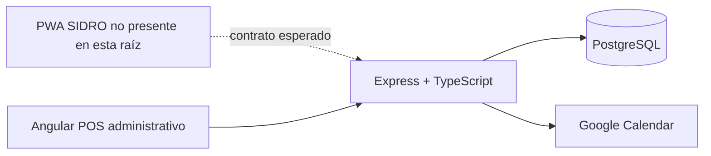

# Arquitectura del sistema

## Implementación observada

- `frontend/` es una aplicación Angular 21 con módulos POS, agenda, empleados,
  configuración y pantallas administrativas SIDRO.
- `backend/` es una aplicación Express 5 ejecutada desde `src/index.ts`; registra
  rutas POS, rutas SIDRO y un worker periódico de Google Calendar.
- PostgreSQL se accede mediante un `Pool` de `pg` en `src/database/db.ts`.
- No se encontró un servicio separado para la PWA SIDRO. Las rutas públicas
  `/api/sidro/*` son el backend disponible para ella.
- El frontend administrativo usa `environment.apiBaseUrl`; las rutas POS agregan
  `/api`, mientras que `sidro-admin.service.ts` omite ese segmento.

## Flujo principal

1. POS o PWA autentica y recibe un JWT.
2. La PWA consulta servicios/profesionales, disponibilidad y crea solicitudes.
3. El administrador o profesional lista, aprueba, rechaza o propone horarios.
4. Una cuenta SIDRO vinculada puede convertirse en una cita POS oficial.
5. La cita inserta un trabajo en `google_calendar_sync_queue`.
6. El worker intenta crear eventos en los calendarios configurados.

## Límites de verificación

No hay evidencia local de infraestructura, CI/CD, instancia PostgreSQL, PWA
independiente, proveedor de secretos ni observabilidad externa.
