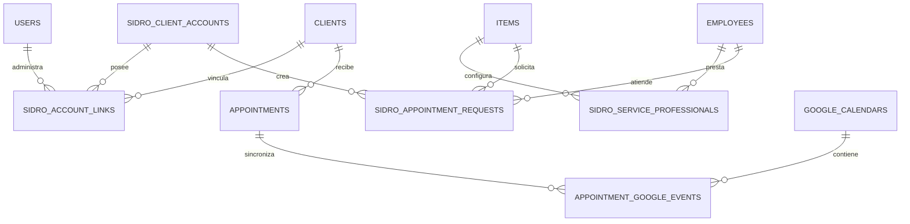

# Esquema PostgreSQL

## Fuente de verdad disponible y discrepancias

Se encontró el dump estructural [pos_carmita_esquema_sin_datos.sql](../pos_carmita_esquema_sin_datos.sql),
completado el 2026-10-15 20:02:32. Es la evidencia más completa disponible del
esquema esperado: contiene extensiones `btree_gist` y `pgcrypto`, 27 tablas,
secuencias, restricciones, índices, trigger y claves foráneas, sin datos de
negocio. No equivale a una inspección de una instancia activa.

El dump consolidado contiene simultáneamente dos generaciones de SIDRO:

1. El runtime TypeScript usa `sidro_service_professionals`,
   `sidro_employee_schedules`, `sidro_employee_blocks` y
   `sidro_appointment_requests`.
2. También existen `employee_working_hours`, `employee_time_blocks`,
   `employee_services` y `appointment_requests`, con restricciones GIST y
   estados distintos.

Por tanto, el archivo confirma que ambas familias forman parte del esquema
exportado, pero no demuestra que la familia alternativa sea usada por la
aplicación. La documentación anterior debe tratar `pos_carmita_esquema_sin_datos.sql`
como fuente estructural primaria y las migraciones como historial/origen.

## Entidades relevantes

| Tabla | Papel | Relaciones/controles declarados |
|---|---|---|
| `users` | usuarios POS | roles `admin`/`user` |
| `clients` | clientes históricos | UUID |
| `items` | productos/servicios | `is_reservable`, duración y padding SIDRO |
| `employees` | profesionales | FK desde configuración y citas |
| `appointments` | citas oficiales | cliente, servicio, profesional, fechas |
| `sidro_client_accounts` | cuentas PWA | teléfono/email únicos, hash |
| `sidro_account_links` | vinculación histórica | índices únicos parciales activos |
| `sidro_service_professionals` | servicio-profesional | unique compuesto |
| `sidro_employee_schedules` | turnos semanales | trigger anti-solapamiento |
| `sidro_employee_blocks` | bloqueos diarios | FK a profesional |
| `sidro_appointment_requests` | solicitudes | estados e índice temporal |
| `google_calendars` | calendarios destino | `calendar_id` único |
| `appointment_google_events` | idempotencia de eventos | unique cita-calendario |
| `google_calendar_sync_queue` | cola | usada por el worker; definida en el dump consolidado |

## Diagrama

El dump sí contiene `google_calendar_sync_queue`, con PK `id`, FK de
`appointment_id` a `appointments` con `ON DELETE CASCADE` y FK de
`employee_id` a `employees`. También contiene `appointment_google_events` con
unicidad `(appointment_id, google_calendar_id)` y cascada desde la cita.

## Integridad y migraciones

La familia alternativa `appointment_requests` sí tiene una exclusión GIST para
intervalos del mismo profesional cuando `estado = 'PENDIENTE_VINCULACION'`, y
`employee_working_hours` tiene exclusión GIST contra turnos solapados. La
familia usada por el runtime (`sidro_appointment_requests`) no tiene esa
exclusión: sólo tiene índices por cuenta y por profesional/fecha. No existe en
el dump una restricción general que impida solapamientos en `appointments`.
